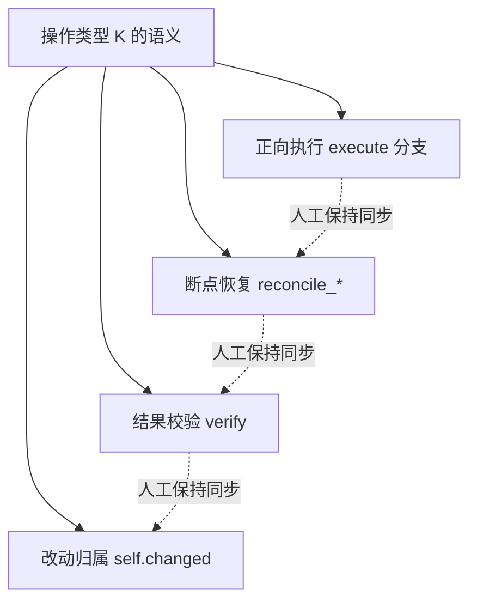
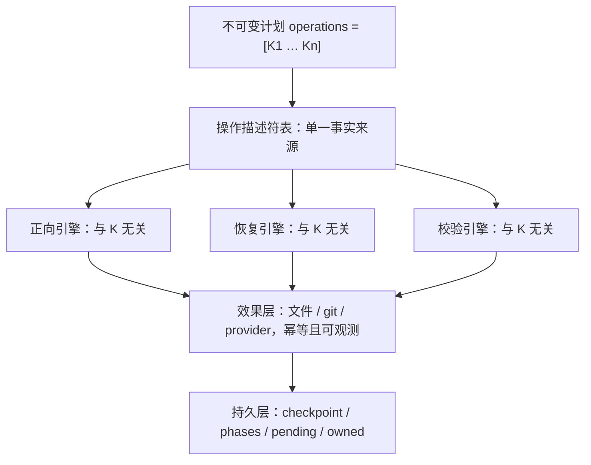

# 执行器设计审阅

本文记录对 `src/cli/src/engine.py` 中执行器的设计审阅结论。审阅对象是 `Executor.execute` 的分派、`Provider.ensure`、`materialize`、`finish`，以及 `phase` 与 `reconcile_*` 恢复逻辑。目标不是逐行找缺陷，而是判断其结构是否可维护、可扩展、可恢复。本文只到设计层，不改变现有实现。

## 形式化模型

系统可建模为一个带持久状态的迁移系统，其状态由不可变计划、真实环境与持久日志共同决定。

```text
R     仓库集合            Id   操作标识集合
Kind  操作类型

Π = ⟨id, version, scenario, O, names, before, checks⟩   不可变计划
O ⊆ Id × Kind × R × …                                   已确认操作序列

Env = ⟨remote, remote_exists, repository_id, owner_id,
        local, status, branch, origin, rules⟩            单仓观测
E   : R → Env                                            真实环境
π   : Env → Env                                          漂移比较用投影

S = ⟨completed, checkpoint, phases, pending,
     owned_files, owned_content, status, current⟩        持久状态

δ     : O → (E → E)                分派，当前为偏函数，运行期才判定定义域
snap  : ℘(R) × Option(Θ) → (R → Env)   观测，baseline 可选
```

迁移关系为 `⟨S, E⟩ --o--> ⟨S', E'⟩`，当且仅当 `o` 未完成、前置条件成立、`E' = δ(o)(E)` 且 `S' = post(o, S)`。

## 不变量

一份正确实现应满足以下不变量。

1. 良构：`∀ o ∈ O. o.kind ∈ Kind`，计划准入时即校验；
2. 单调：同一仓库的阶段序列在偏序上严格递增；
3. 一次：每个外部效果在任意中断与恢复序列中至多执行一次；
4. 健全：漂移判定使用纯投影 `π`，与调用路径无关；
5. 归属：实际改动集等于声明的 `owned`；
6. 纯粹：内容变换与调用顺序无关；
7. 可恢复：任意中断点都存在使其前进或安全停机的迁移。

## 缺陷

| **编号** | **缺陷** | **违反** | **代码位置** |
| :-- | :-- | :-- | :-- |
| D1 | 分派未在准入时校验，运行中途才失败 | 良构 | `execute` 尾部 `else` |
| D2 | `committed` 状态重载、非单射 | 单调 | `ensure` 初始提交与 `finish` 提交 |
| D3 | `snapshot` 依赖调用路径，本地阶段不重读远端 | 健全 | `snapshot` 的 `baseline` 分支 |
| D4 | 引用替换非合流且边界不完整 | 纯粹 | `replace-references` |
| D5 | 无统一幂等层，逐处理器自实现 | 一次 | 创建回执、`push_verified`、`reconcile_*` |
| D6 | 归属手工维护，仅单向保证 | 归属 | `self.changed` 与 `finish` 校验 |
| D7 | `rename-repo` 缺恢复迁移 | 可恢复 | `Provider.rename` |
| D8 | 阶段轨迹依赖内容相等性 | 单调、可恢复 | `write` 早返回 |
| D9 | 状态模式未纳入兼容键 | 契约完整 | `load_plan` |
| D10 | 领域文档正文构造不唯一 | 可读性 | `domain-docs` 分支 |

其中 D2、D5、D7 直接决定中断后能否安全接续，影响最大；D3、D4、D6 影响正确性；D1、D8、D9、D10 影响体验与维护。

## 本质原因

十条缺陷并非孤立，而是同一结构病的症状：这套程序没有单一事实来源，同一个工作流被三套并行代码各写了一遍——正向执行、断点恢复、结果校验。三套代码必须靠人工保持一致，而这份同步关系没有被任何类型或模型约束。换言之，真正的状态机是隐含在命令式分支里的「影子状态机」，恢复与校验只是照着它另抄的一份。



这一结构之所以是本质的，在于它决定了扩展成本：每新增一种操作，要改的不是一处而是约四处，且失误面随操作种类数增长。修好其中任何单条缺陷，都不减少「必须同步的副本数」。更深一层的成因是，系统把「效果」当成语句而非一等对象，于是幂等、恢复、校验只能逐个操作手写。

## 收敛设计

改法的核心是把每种操作的语义收敛成一份声明，让正向、恢复、校验都从它派生。下表给出描述符字段及各自对应的现状。

| **字段** | **含义** | **现状对应** |
| :-- | :-- | :-- |
| `pre` | 前置条件 | 各分支内的 `require` |
| `desired` | 纯函数，算出目标内容与引用，不碰外部 | 分支内联的字符串拼接 |
| `apply` | 幂等效应 | `materialize`、`finish` 等命令 |
| `reconcile` | 断点接续谓词 | 各种 `reconcile_*` |
| `verify` | 成功判据 | `verify` 内的判断 |
| `observe` | 漂移比较用纯投影 | `snapshot` 的形状 |
| `writes` | 声明的写集 | 手工 `self.changed.add` |
| `stages` | 该操作会发出的阶段 | 散落的 `phase` 调用 |

收敛后的引擎只认描述符接口，与具体操作种类无关：

```text
正向引擎（与 K 无关）:
  for op in Π.operations, op.id ∉ S.completed:
      require  pre(K)(S, E)
      Δ      = desired(K)(E)
      E      = apply(K)(Δ, E)
      S      = advance(S, observe(K)(E))
      S.owned ∪= writes(K)

恢复引擎（与 K 无关）:
  if S.pending = Some(op, stage):
      if reconcile(op.kind)(stage, S, E) = Some S':  S = S'
      else:                                          halt_safely()

校验引擎（与 K 无关）:
  ∀ op ∈ Π.operations.  verify(op.kind)(E)   ⟹  passed
```



收敛后，新增一种操作只需增加一行描述符，引擎、恢复与校验的代码都不动。判断收敛是否成功，可用此标准衡量：若新增操作仍要改动三处以上，说明系统仍停留在影子状态机的形态。

## 结论

那十条缺陷是症状，本质是知识重复与影子状态机。单点修复治标；把操作语义收敛成一份声明、让恢复与校验派生自它，才治本。作为演示程序，这些细节可以暂不处理；若执行器要继续扩展，最先应做的架构动作是这条收敛。

按用户文档把范围收敛到初始化之后，可执行的简化路径见 [初始化执行器简化重构方案](./refactor-plan.md)。
