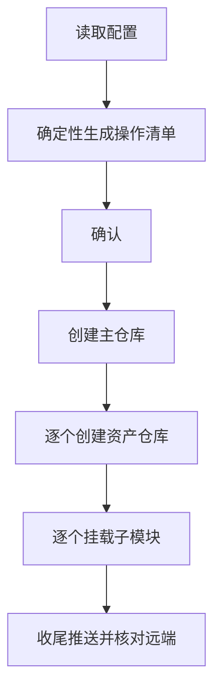

# 第二大脑初始化开发指南

本指南面向实现者，说明[初始化用户指南](../user-guide/)所描述功能的内部设计。两者分工不同：用户指南给行为契约——初始化做什么；本指南给实现契约——凭什么判定做对了。

范围只到初始化：把一个新领域的第二大脑从零建起来。补全、追加、挂载产品、聚合、更名、发布均不在本版内。

## 只做三件事

- 创建主仓库与所选配套资产仓库；
- 写入初始文件；
- 把配套仓库作为子模块挂载到主仓库的标准坐标下。

不改动其他领域，不遍历组织，不臆测领域语义。程序只校验命名格式，领域含义由人确认后写入配置。

## 形式化规则

### 实体

```text
D = ⟨short, english⟩                    领域：简称与英文名
A = {platform, toolkit, laboratory,
     context, journal, intention}       资产类型，固定封闭集合
V ∈ {public, private}                   可见性，缺省 public
provider ∈ {local, github}              提供方，缺省 local
```

### 命名与坐标

仓库名与挂载坐标由领域与资产类型唯一确定，不引入额外参数。主仓库取 `quanttide-{简称}`，配套仓库按下列模式生成：

| 资产类型 | 仓库名 | 挂载坐标 |
| :-- | :-- | :-- |
| 应用云 | `qtcloud-{简称}` | `apps/qtcloud-{简称}` |
| 标准库 | `quanttide-{简称}-toolkit` | `packages/quanttide-{简称}-toolkit` |
| 实验室 | `quanttide-laboratory-of-{英文名}` | `examples/default` |
| Context | `quanttide-context-of-{英文名}` | `data/context` |
| Journal | `quanttide-journal-of-{英文名}` | `data/journal` |
| Intention | `quanttide-intention-of-{英文名}` | `data/intention` |

其余类型（archive、report、library 等）套用同一组模式，按需追加，不预建空仓库。

### 初始化

```text
init(cfg),  cfg = ⟨D, Asel ⊆ A, V, provider, workspace, run_dir⟩:
    create  repo(D)              with initial file
    ∀ a ∈ Asel:  create  repo(a, D)  with initial file
    ∀ a ∈ Asel:  mount   repo(a, D) → repo(D) @ mount(a)
```

初始化的含义就是这一串动作：先建主仓库，再建所选资产仓库，最后逐个挂载。没有分支、没有条件场景。

## 不变量

实现是否正确的判据。

1. **命名封闭**：所创建仓库的每个名称都等于某个命名函数作用于 `D`，无自由命名；
2. **位置固定**：每个挂载坐标由资产类型唯一确定；
3. **非空**：作为子模块目标的仓库至少有一个提交，否则指针不可解析；
4. **可见性一致**：同一次初始化创建的所有仓库取同一 `V`；
5. **不越界**：只处理主仓库与 `Asel` 内的资产仓库，不遍历组织；
6. **有确认**：每个远程写操作之前存在一次确认；
7. **幂等**：重复初始化收敛到同一结果，不产生重复仓库或重复挂载；
8. **可恢复**：任意中断后重跑能前进或安全停机，外部效果至多一次。

## 操作模型

初始化的全部外部动作收敛为四种操作。每种操作声明其前置条件、纯目标、幂等效果与成功判据，成为唯一事实来源；执行、恢复、校验都从它派生，不各写一遍。

| 操作 | 前置条件 | 效果 | 幂等 |
| :-- | :-- | :-- | :-- |
| 创建仓库 | 目标不存在 | 建仓并写初始文件 | 已存在且非空则通过 |
| 写初始文件 | 仓库存在 | 写 README | 内容一致则跳过 |
| 挂载子模块 | 双方存在 | 写 `.gitmodules` 与指针 | 引用一致则跳过，不一致则刷新 |
| 收尾推送 | 本地有提交 | 推送并核对远端 | 远端已含目标提交则跳过 |

创建必须带初始文件，正是为满足不变量三：云端仓库一建好就有提交，子模块指针才可解析。

一轮初始化的顺序固定如下：



### 每仓库状态机

单个仓库在初始化中的状态很少，且严格单向：

```text
未创建 → 已创建 → 已挂载 → 已推送
```

主仓库经历未创建 → 已创建 → 已推送；资产仓库额外经历已挂载。

## 幂等与恢复

- **创建**：对已存在且非空的仓库直接通过，不因重复创建报错；
- **挂载**：对被挂载过的目录比较现有引用，一致则跳过、不一致则刷新；
- **收尾**：推送前先核对远端是否已含目标提交，避免重复推送或误判失败；
- **重跑**：上述效果各自幂等，重跑 `init` 即整体收敛。

重跑收敛是唯一的恢复手段——不需要逐操作手写接续逻辑，只要每个效果幂等。

## 请求配置

初始化由配置驱动，可见性、资产选择、提供方都取自配置，不写死，以便同一套规则既能建公开资产，也能建尚未公开的资产。输入包括领域简称、领域英文名、所选资产类型、可见性、提供方与工作区。字段定义见工具自带的[请求配置](../../src/cli/docs/request-schema.md)。

## 运行

Python 3.10 以上、PyYAML 6、Git 三者必需；操作公开 GitHub 时另需已登录的 GitHub CLI。缺省 local 模式只创建本地仓库；需要云端仓库时在命令里指定提供方与账号或组织。

```sh
python3 src/engine.py init --config request.yaml --workspace <工作区> --run-dir <记录目录>
```

## 验收判据

- 新增一种资产类型只需增加一行命名与挂载声明，执行、恢复、校验的代码不动；
- 单次 `init` 在 local 与 github 两种模式下都建成主仓库与所选资产仓库，并挂载到正确坐标；
- 中断后重跑 `init` 收敛到同一结果，无重复仓库或重复挂载；
- 配置为 private 时，创建出的仓库均为私有；
- 任一不变量不满足时，`init` 在确认之前拒绝执行。
